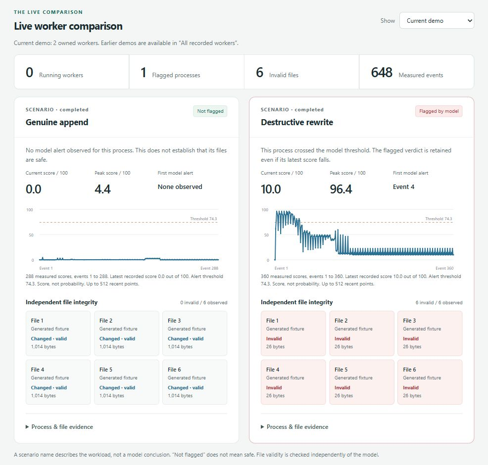

# XRan / RanEval ransomware research laboratory

A reproducible research workspace spanning original XRan processed Windows features, historical Linux/EN2025 experiments, and the current **native Windows streaming fixture laboratory**. The dashboard runs harmless Windows workers beside Docker inference and independently checks their generated files. No malware is executed by the demo.

The shipped native model detected **24/24 destructive fixture campaigns** and falsely alerted on **2/32 benign campaigns (6.25%)** in its saved fresh test. These controlled template-based behavior results do not establish ransomware-family recall or production protection. Workers continue after alerts; the current demo does not contain or restore files. [Results and limits](docs/RESULTS.md).



## Run on Windows

Prerequisites: Windows 11, PowerShell, Python 3.11 or 3.12, [uv](https://docs.astral.sh/uv/getting-started/installation/), Git with access to this private repository, and Docker Desktop configured for Linux containers:

```powershell
git clone https://github.com/darkmodepdf/xran-ransomware-lab.git
cd xran-ransomware-lab
./setup.ps1 -Profile Demo
./start.ps1
```

Use the authenticated browser session opened by the launcher at `127.0.0.1:8767`. Select **Run side-by-side demo**. Each worker operates on six generated files in an owned temporary directory. View model alerts separately from file validity. Keep the session URL and locally generated credentials private.

Stop the foreground session with Ctrl+C, or use the lifecycle helper from another PowerShell window:

```powershell
./stop.ps1
```

The launcher refuses to take over a busy port. [Configuration, lifecycle and troubleshooting](docs/OPERATIONS.md).

If Docker is installed but stopped, start launches the installed Docker Desktop and waits up to 120 seconds. It requires Linux containers and does not switch engines.

## Train and test

Native fitting needs the Native profile; inference and fixture workers use the Python standard library. Reproduction writes a separate experiment and model rather than replacing the deployed bundle.

```powershell
./setup.ps1 -Profile Native
./helpers/reproduce-native.ps1
./test.ps1 -Suite Windows

# Historical training and the complete repository test suite:
./setup.ps1 -Profile Research
./test.ps1 -Suite All
```

[Reproduction guide](docs/REPRODUCIBILITY.md) explains fresh campaigns versus frozen-record replay. Dataset downloads and Kaggle submissions are separate explicit research actions.

## Documentation

| Guide | Contents |
|---|---|
| [Architecture](docs/ARCHITECTURE.md) | Collection, actor isolation, models and trust boundaries |
| [Operations](docs/OPERATIONS.md) | Configuration, lifecycle and troubleshooting |
| [Reproducibility](docs/REPRODUCIBILITY.md) | Dependency profiles, fitting, replay and test scope |
| [Results](docs/RESULTS.md) | Native metrics, historical baseline and limitations |
| [Datasets and rights](docs/DATASETS.md) | Acquisition, provenance and redistribution boundaries |
| [Research map](docs/RESEARCH.md) | Original XRan, Linux, EN2025 and current records |
| [Project structure](docs/PROJECT.md) | Source, helpers, bundles and generated outputs |
| [Legacy README](README.legacy.md) | Preserved prior instructions and historical context |
| [Native technical runbook](demo/windows_streaming/README.md) | Event, worker and security details |

Selected project-trained XRan counts/CNN/GRU endpoint bundles are preserved under [models](models/README.md), with a portable [saved evaluation](docs/experiments/xran-endpoint/evaluation.json). These are our trained models; original author weights are not claimed.

Original XRan processed endpoint features are a different representation and experiment from the measured native streaming forest. This repository does not claim to reproduce the authors' published results. Historical README statements describe their date and track; use the guides above for the current entry point.

See [NOTICE](NOTICE), [contribution guidance](CONTRIBUTING.md), and [security reporting](SECURITY.md). Repository access does not grant redistribution rights for third-party papers, datasets or software.
