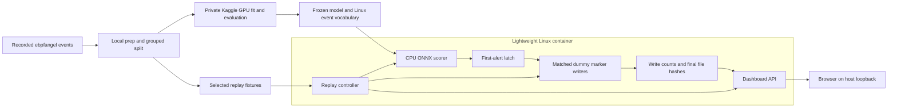

# Linux ransomware telemetry dashboard

## Design paradigm

Versioned artifacts connect training and replay. A single service owns each live dashboard session and controls the disposable workload inside a slim Linux container. The browser reads that service's scores and write decisions.

## Inherited invariants

| Parent rules | Application to the Linux pilot |
| --- | --- |
| AD-1 to AD-3 | Preserve input identity, outcome separation and a causal observation order. |
| AD-4 and AD-5 | Freeze grouped statistical roles and count misses in detection outcomes. |
| AD-6 and AD-7 | Verify the Kaggle resource and recovery envelope. Limit claims to verified evidence. |
| AD-8 | Preserve the paired fixture and write-order rules. This Linux dashboard adds a loopback UI to the existing demonstration pattern. |

## Invariants and rules

### AD-1 — Linux event order and labels

- **Binds** data preparation, GPU training and fixture staging.
- **Prevents** treating benign background activity as ransomware, mixing Windows and Linux vocabularies, and learning from label-bearing metadata.
- **Rule** Use the ebpfangel source version and author's capture-specific PID labels. Order each process's captured events consistently and record provenance, omitted records and the observed horizon. Supply one event-type token per retained event in RanEval's `apis` sequence. Keep filenames, PID, family, source alert features and outcomes outside the scorer input. The benchmark's observation unit is one captured Linux event. [Source logs](https://github.com/TomasPhilippart/ebpfangel/tree/main/logs) · [Dataset paper](https://ebpfangel.philippart.me/Ransomware_Detection_using_Machine_Learning_with_eBPF.pdf)

On the inspected source revision, the public CSVs resolve 14 of 32 listed training PIDs and all 21 listed test PIDs. Family attribution is available for 18 of those 35 resolved positives across four named families. Use attributable positives for family-held-out evaluation and retain missing and unattributed PID dispositions in the preparation audit. Report both independent capture and family counts alongside process totals.

### AD-2 — Fit and selection use independent recording groups

- **Binds** splits, training, selection, threshold calibration and evaluation.
- **Prevents** reuse of related processes across roles and performance claims based on event rows or PID totals as independent trials.
- **Rule** Assign a capture and any linked ransomware family to one role before fitting. Keep vocabulary and weights train-only. Select the model and early-detection settings on the tuning partition using its benign tuning threshold. Freeze the deployed threshold using the separate benign calibration partition. Compare the fitted causal models on common held-out traces. Report ransomware detections by observation 120 and by each trace's end, first-alert positions and benign alerts with denominators. Also show independent capture counts and distinguish the nominal threshold budget from observed false alarms. Record short and missed traces. Describe the small cohort as a development pilot.

### AD-3 — Kaggle training and CPU deployment share one frozen contract

- **Binds** packaging, GPU runner, export, Linux image and replay.
- **Prevents** accepting a submitted job as a trained model, or serving weights with mismatched vocabulary, replay policy or thresholds.
- **Rule** Package only derived event sequences, provenance and trainer code in private Kaggle inputs. Record actual accelerator, runtime versions, elapsed time, input/config hashes and recovery evidence. Persist weights, metrics and recovery checkpoints as saved outputs, retrieve them and verify the manifest locally. Bind the deployment ONNX model to those weights and freeze the Linux vocabulary, block/horizon policy and threshold alongside it. The CPU graph accepts dynamic `int64` tokens shaped `[1, length]` for the current block prefix and returns the latest endpoint logit shaped `[1, 1]`. Compare CPU ONNX Runtime scores and first-alert positions with streaming CPU PyTorch at the frozen threshold, including prefixes and reset boundaries. The container verifies model and replay fixture identity at startup. [Kaggle notebooks](https://www.kaggle.com/docs/notebooks) · [ONNX Runtime CPU](https://onnxruntime.ai/docs/get-started/with-python.html)

### AD-4 — First alert stops subsequent marker writes

- **Binds** replay clock, scorer, marker writers and outcome verification.
- **Prevents** timing races, post-alert writes in the enforcement lane and claims of recovered or protected real files.
- **Rule** One ordered replay controller attempts each scheduled bounded write in both initially identical generated fixture sets, scores the corresponding event and latches the first finite score meeting the frozen threshold. The alerting observation's write remains counted. The protected lane then denies each later attempt while both lanes receive the same input schedule and scores. Keep the latch across model block resets and clear it on a new run. At termination compare initial and final SHA-256 hashes by fixture and reconcile attempted, allowed and blocked writes. Each published count describes generated demo files.

### AD-5 — Dashboard reflects the replay and its limits

- **Binds** the launcher, local HTTP service and dashboard.
- **Prevents** display state drifting from runtime state and simulated load appearing as an observed infection.
- **Rule** Launch the service as an unprivileged user on a read-only image with disposable writable storage for generated files. Publish the UI on host loopback and use read-only prepared artifacts. Accept only bundled fixture selection and bounded replay settings. The browser shows the current scenario, event progress, score and threshold, first alert, gate status, allowed and blocked writes and final hash verification. Distinguish configured pacing from observed events per second under stress. Show a benign control and the actual result of the fixed ransomware replay, including a miss. Label any additional trace chosen because it alerts as illustrative and select it from development traces independently of the held-out result. [Docker port publishing](https://docs.docker.com/engine/network/port-publishing/)

## Execution and evidence

| Step | Completion evidence |
| --- | --- |
| Prepare Linux captures | Checksummed source and prepared cohort audit. Capture and family groups are disjoint and parser output is deterministic. |
| Train and freeze | Kaggle job completes with verified GPU environment, durable output manifest and held-out alert rows. |
| Export and stage | Verified ONNX identity and PyTorch parity for staged clean and ransomware traces, including threshold crossings and reset handling. |
| Run the dashboard | Test clean and ransomware replays, latch timing, matching initial fixtures and blocked-write hash integrity. Repeat at a higher configured pace and record achieved throughput, alert position and elapsed times. |

The pilot measures response on recorded telemetry and generated files. Production host collection, enforcement on arbitrary processes and estimates of real files lost or saved require a separate validation protocol.
