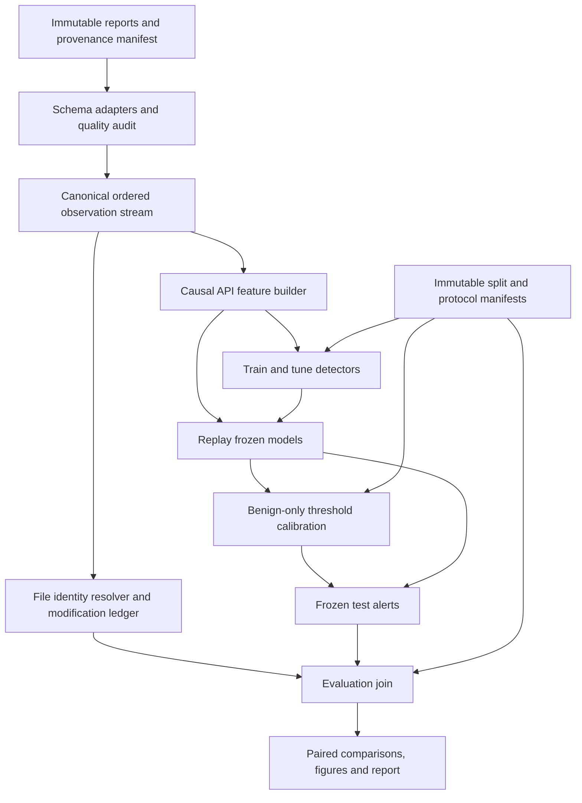

# Streaming ransomware evaluation: execution plan

Version 1.1 | 2026-11-16 | Team: user + Codex | GPU: Kaggle | Response demo: Docker

This implementation blueprint integrates the revised research protocol and the Docker demonstration. The [runbook](../../../README.md) covers the executable development pilot and demo. The 8-10 week schedule is a planning estimate that depends on data feasibility and compute availability.

Read with [architecture rules](architecture-streaming-ransomware.md) and [data/evaluation contracts](CONTRACTS.md). These three documents have distinct roles: this file owns work order and delivery gates; the architecture owns boundaries; CONTRACTS owns schema and evaluation semantics. Changes must update all affected documents before a new experiment version.

## 1. Intended result

Build a reproducible offline benchmark that answers:

1. At a common nominal trace-level false-alarm budget, how many distinct files have been observably modified by the time each detector first alerts?
2. Do model comparisons based on modification burden agree with comparisons based on fraction of the recorded trace observed?

Use the term **observed modification burden** until file-content evidence supports a stronger damage claim. This benchmark estimates alert timing on recorded behavior; it does not demonstrate that deployed software prevented damage. A useful result may be a ranking reversal, agreement, a tradeoff, or an inconclusive comparison. Publication acceptance and a preferred model winning are not success criteria.

Minimum deliverable: data-quality report, validated replay/evaluation library, three baseline detectors, a frozen grouped evaluation, uncertainty estimates, reproducibility package, and manuscript/report draft. A defensible data-infeasibility result is a gate outcome, not permission to manufacture a damage metric.

## 2. Changes to the original guide

| Original direction | Revised decision | Reason |
|---|---|---|
| Files ruined from write/rename/delete names | Successful, identity-resolved modifications; separate existing/new/unknown targets | API names alone do not establish destruction |
| 0.5%, 1%, 5% equal-FPR comparisons | Primary 5% nominal calibration budget; exploratory 1%; actual test FPR always shown | Small benign sample count limits low-FPR inference |
| All four architectures mandatory | Counts + logistic regression, CNN, GRU mandatory; Transformer conditional | Finish measurement and evaluation first |
| XRan reproduction | Explicit XRan-inspired CNN; optional separately labeled multi-view adaptation | Original implementation details and dataset differ |
| All models merely share splits | Also share causal information, observation cadence, memory policy and training-prefix sampling | Prevent architecture/training/feature confounding |
| Three class metrics with one score | Binary ransomware versus non-ransomware; benign and other malware separate negative strata | Align task and output |
| Misses receive worst-case damage | Misses receive terminal observed burden and remain failures in success curves | Recording ends are not worst-case future damage |
| Family-held-out unconditionally | Family-held-out only with validated labels; otherwise honest group-held-out results | A cluster is not a confirmed malware family |
| Full real-time implication | Ideal observation replay first; latency/backlog sensitivity separately | Avoid unsupported prevention claims |

## 3. Architecture and work ownership

Use a modular batch pipeline in one Python repository. A database server, web application, microservices, paid model APIs, and orchestration platform are unnecessary for the first version.

The feature path never reads the outcome ledger or finished-report signatures. The evaluator joins them only after predictions exist. One shared replay engine owns observation order, context boundaries, horizon and alert timing for every detector.

Codex owns code, parsers, tests, run configurations, diagnostics, result analysis and draft artifacts. The user owns account/login actions, dataset access or release permissions, mentor decisions when applicable, and project priorities. User and Codex review gate evidence together. Routine reversible implementation proceeds autonomously once requested; changing the research question after a failed data gate requires an explicit decision.

## 4. Data feasibility before neural networks

Published EN2025 counts are 919 benign, 733 ransomware, 816 RAT and 792 spyware: 3,260 samples, not a verified 3,180 usable. The publisher reports 2.6 GB compressed and 77.9 GB expanded. These are source facts, not measurements of our eventual working subset. [Publisher record](https://zenodo.org/records/18218588)

Start with a deterministic 100-report pilot, nominally 25 per source class, covering available schema variants and trace lengths. Pilot traces and their duplicate groups are development-only and cannot later enter the untouched test set. Inspect global metadata before split locking; manually inspect behavior only in the development pilot. Record every exclusion and its reason.

Before extraction, calculate needed space for archives, the largest live extraction unit, canonical output, temporary writes, and checkpoints with at least 20% headroom. Do not extract the entire 77.9 GB collection onto a Kaggle session by default. Process locally or in source shards; attach compact, read-only canonical artifacts for GPU work. Measure compression ratios and peak RAM on the pilot before scaling.

Pilot deliverables:

- Provenance manifest, schema inventory, class counts and parser failure counts.
- API return-status, file-argument, handle, timestamp and repeated-field availability.
- Trace duration/length distributions, termination evidence, inactive and truncated strata.
- Trustworthy family-label coverage and deduplication groups.
- Per-trace distinct-file counts with existing/new/unknown-origin categories.
- At least 30 hand-checked timelines: 20 ransomware and 10 negative examples, deliberately including failed writes, rename chains, handle reuse, repeats and child processes.

Proposed engineering gates, finalized detector-blind after the pilot:

| Gate | Acceptance evidence | Failure response |
|---|---|---|
| G1: ingestion | Every source member accounted for; failures quarantined; deterministic rerun hashes | Fix adapters; no silently discarded records |
| G2: file identity | All synthetic golden cases correct; zero unexplained mismatches on hand-checked cases; pipeline resolution target >=95%; exact primary damage cohort requires 100% resolution of potentially qualifying operations within its horizon | Fix parsing or publish a smaller exact cohort plus coverage limits; incomplete outcomes are bounds/unknown, never exact zero |
| G3: observation order | Every primary trace has defensible global observation/block order; repeats and ties explicitly modeled | Restrict cohort or change to process-level/partial-order study before training |
| G4: useful outcome | Primary cohort has enough independently grouped active ransomware and a nondegenerate modification distribution | Seek better existing logs; do not silently substitute trace fraction |
| G5: statistical support | Aim >=100 eligible ransomware test traces, >=10 verified test families/groups, and >=200 independent benign calibration and test traces each | Reduce inferential claims, add data, or return to mentor; these are planning targets, not a power guarantee |

For G4, flag a weak-range outcome if more than 80% of eligible active traces end with at most one resolved modified file. Inspect other distributions rather than treating this heuristic as a universal statistical cutoff. Structural parsing rules may use the development pilot; no rule is selected to improve a detector's test result. Resolution coverage must be reported by class/family and trace, not only pooled across events.

## 5. Representation and models

Primary inputs are API-name IDs only. Exclude paths, executable names, hashes, class/family strings, report verdicts, signatures, `ttps`, final trace length and outcome annotations. Fit vocabulary on training traces; use explicit PAD and UNK tokens. Store position and block boundaries outside token IDs.

A concrete starting history policy is non-overlapping blocks of W=1,024 canonical observations. All detectors reset at the same block boundary, see the same prefix within that block, and produce a score after every observation. This bounds CPU/GPU cost while letting the entire observed trace contribute alarms. It is an engineering assumption, not a property of XRan. Report boundary effects; W=512 or 2,048 is a predeclared optional development sensitivity. Choose W once based on pilot throughput and memory, before model comparisons.

The primary observation horizon is each complete available recording, with a shared resource cap H if the pilot makes uncapped replay infeasible. Select H from development profiling, freeze it in the protocol, mark capped traces as right-truncated, and report the excluded tail. Never silently drop long traces or compare different horizons across models. Repeat-compressed logs may require block-level observations; call them that rather than inventing individual timestamps.

| Model | Starting configuration, subject to development tuning | Role |
|---|---|---|
| API counts + logistic regression | Raw incremental block counts; train-fitted variance scaling without centering; C in {0.1, 1, 10} | Checks whether sequence modeling adds value |
| Two-layer causal CNN | Embedding 64; two 64-channel kernel-5 causal convolutions; dropout 0.1; prefix max pooling; dense 64; one logit | XRan-inspired streaming adaptation |
| GRU | Embedding 64; one unidirectional 128-unit GRU; one logit | Compact order-aware baseline |
| Optional Transformer | Two causal layers, width 128, four heads, feed-forward 512; block-local cache | Additional candidate only after core completes |

The CNN uses left-only convolution and a running prefix maximum, allowing incremental inference. It is intentionally labeled an adaptation: exact XRan used merged 500/10/10 inputs with incompletely reported architecture. For the GRU/CNN, tune at most three predefined configurations each; keep their final trial lists in a committed config. Model scores are not called calibrated probabilities.

Training uses a single immutable endpoint manifest shared across architectures and training seeds. Start with 16 unique endpoints per trace (or all positions if shorter), mixing early/log-spaced and uniform observed positions; store a separate fixed data-sampler seed and endpoint identities. Reuse these endpoints every epoch, including for logistic-regression training, so models do not receive different prefix populations. Give each trace equal total loss/sample weight so long logs do not dominate. Use binary cross-entropy with logits for neural models; choose any class balancing from training only and log it. Early prefixes inherit eventual trace labels as weak supervision; discuss this limitation. Validation selection uses the same detector-blind objective and no calibration/test data.

Optional multi-view experiment: build DLL/mutex histories from causally available events. Keep its comparison separate; compare matched feature access when making architecture claims. A first-500-call legacy-style CNN and a prefix-trained adaptation may be compared as an ablation, not conflated with the primary benchmark.

## 6. Experimental design and finite run budget

Use the exact metrics, splits, calibration algorithm, miss treatment and paired statistics in [CONTRACTS.md](CONTRACTS.md). The nominal calibration target is 5%, with 1% exploratory. A 5% operating point is a research comparison, not a production acceptability claim.

Core budget: at most 9 tuning fits (three configurations for each of three models), followed by five final seeds per selected model (15 fits). Deterministic logistic-regression repeats may be omitted, provided sampling and solver are also deterministic. Optional Transformer adds 8 fits; optional random/group-relaxed reference adds 6 fits. Ceiling: 24 core and 38 with both options. Additional runs require a recorded reason, not repeated searching for a desired ranking.

Freeze primary split membership. Select hyperparameters on tuning data using mean success over a fixed trace-fraction grid at a tuning-derived 5% empirical benign budget; use final training loss only as a deterministic tie-breaker. This objective avoids selecting directly for damage-ranking reversals. Then freeze models, calibrate on the independent benign calibration set, and evaluate test once. Do not refit on train+tune in v1.

Before revealing test outcomes, freeze protocol, models/seeds, vocabulary, cohort rules, thresholds, metric grids and claim templates in a hashed manifest. Test is unavailable to training and tuning loaders. If a serious implementation bug is discovered after reveal, record invalidation, explain the fix, rerun the whole affected comparison, and disclose the revised evaluation; never silently relabel the same test as untouched.

## 7. Runtime, checkpointing and Kaggle

Use Python, PyTorch for neural models, scikit-learn for logistic regression, PyArrow/Parquet for canonical tables, standard JSON for manifests and ordinary plotting tools for figures. Use a single package/CLI plus thin notebooks. No web starter is appropriate. Official documentation was checked for these tools; exact package/CUDA pins are chosen only after inspecting Kaggle's actual image and running compatibility tests. Do not upgrade the entire CUDA/PyTorch stack to match documentation versions.

At session start, record GPU model/count/VRAM, CPU/RAM, disk, package versions, internet availability, remaining account quota and applicable notebook/competition rules. Kaggle's notebook documentation lists 12-hour CPU/GPU sessions and 20 GB of saved working storage. Confirm the actual session and account limits before scheduling a long run. [Kaggle notebooks](https://www.kaggle.com/docs/notebooks)

For these small models, start with one GPU. If T4 x2 is available, two independent experiment workers are likely simpler than DDP; benchmark before choosing. If DDP is justified, one process per GPU, distributed data sharding, coordinated saving, and effective batch = microbatch x GPU count x accumulation. DDP does not combine GPU memory. Use FP16 on T4 where stable, not assumed native BF16.

If verified session limits permit, use a configurable 10-hour total session budget starting before setup, reserving at least 30 minutes for evaluation/export; increase reserve based on measured save/evaluation duration. Shorter verified limits override this default. Save full recovery checkpoints every 10-20 minutes: model, optimizer, scheduler, scaler, RNG, sampler/epoch/data cursor, global step, config and manifest hashes. Save atomically; keep recent/best checkpoints and temporary-write space. Test interrupted restart and matching next-step behavior before any long run.

Read attached artifacts from `/kaggle/input`; write to `/kaggle/working`. Tokenize once. Calibrate total loader workers and microbatches using pilot throughput/VRAM. Save & Run All only after a complete train/evaluate/save/restart smoke test. Confirm saved outputs can be retrieved outside the active session. Transfer compact prepared data and results; raw-report parsing remains a separate CPU job unless the measured environment makes another split preferable.

## 8. Milestones and acceptance checks

Weeks are effort envelopes assuming regular collaboration. G1-G5 failure changes the schedule; the original 8-10 week estimate is not retained by skipping gates.

| Stage | Estimate | Concrete output | Done when |
|---|---|---|---|
| M0: specification and prior art | Week 1, 2-3 workdays | Requirements, source comparison matrix, data terms, pilot manifest | Claim boundaries and protocol questions documented; no unsupported novelty statement |
| M1: data feasibility | Weeks 1-2, 4-6 days | Audit report, pilot timelines, quality gates, fallback decision | G1-G5 assessed with evidence; primary outcome/cohort feasible |
| M2: measurement vertical slice | Weeks 2-3, 4-6 days | Parser -> ledger -> replay -> toy alerts -> report | Golden cases and suffix-invariance checks pass; no neural model required |
| M3: count baseline end to end | Week 4, 3-4 days | Real train/tune/calibrate/test-dry-run pipeline | Uses development-only dry-run holdout; resumes exactly; produces all report fields |
| M4: CNN/GRU and profiling | Weeks 4-5, 5-7 days | Core models, tuning runs, measured run budget | Incremental/batch equivalence; finite tuning complete; core fits affordable |
| M5: locked benchmark | Weeks 6-7, 4-7 days plus compute queues | Five-seed core results, calibration records, paired intervals | Manifest frozen before reveal; failures recorded; all primary plots generated |
| M6: sensitivity and interpretation | Week 8, 3-5 days | Error analysis, grouping/identity/horizon sensitivity; optional model | No test-driven retuning; uncertainty and limitations explicit |
| M7: research delivery | Weeks 9-10, 5-8 days | Manuscript/report, reproducibility bundle, final walkthrough | Clean rerun regenerates tables; every claim maps to evidence |
| M8: live response demo | After model export | Frozen Kaggle bundle, recorded development trace, generated dummy files and paired Docker results | Same input and checkpoint in both modes, live score parity against offline replay, alert/gate timing, before/after hashes and a benign control |

The private Kaggle development pilot exercises GPU training, checkpoint restart, threshold calibration and export on a bounded EN2025 subset. It may run before the full modification ledger exists because it measures API-only classification and response wiring. The locked damage benchmark still follows the G1-G5 gates and uses a fresh, isolated final test cohort.

## 9. Verification that earns confidence

Required tests are behavioral, not snapshots of implementation:

- File lifetime: open/write/close; reuse; same handle in two processes; rename; duplicate handles; failed operations; existing versus created files.
- Observation semantics: repeated blocks, contradictory clocks, missing time, child processes and simultaneous events.
- Outcome boundary: an alert caused by the first completed modification counts one modified file; a missed inactive trace is never a successful zero-burden detection.
- Causality: appending or changing a future suffix changes neither earlier features nor scores. Full-report metadata poisoning tests cannot change API-only scores.
- Numerical equivalence: incremental and batch-prefix scores match within declared dtype tolerance; alert decisions match on golden fixtures and boundary tests, otherwise standardize evaluation precision.
- Split isolation: duplicate/group IDs never cross roles; train vocabulary contains no held-out-only fitted entries; calibration loader is benign-only.
- Calibration: ties, zero errors, all-equal scores, insufficient negatives and no-alert thresholds behave as specified.
- Recovery: interrupted and resumed training matches an uninterrupted control under deterministic smoke-test settings; checkpoint corruption is detected.
- Integration: tiny fixture corpus regenerates a known report with exact denominators; rerunning the pipeline does not overwrite completed runs.

Before expensive runs, inspect counts/ranges, gradient finiteness, learning curves on a tiny overfit fixture, throughput, peak VRAM, save time, and replay cost. No GPU examples are claimed validated until executed.

## 10. Failure routes and stop conditions

| Failure | Route that preserves honesty |
|---|---|
| File identity available, victim status absent | Distinct modified identities with new/unknown strata; remove ruined-file claims |
| Identity missing but successful modifications observable | New protocol for modifying-operation burden; explicitly change outcome and question |
| Global chronology lost | Reliable subset or process-level/partial-order analysis; no unsupported sample-wide first alert |
| Repeat timing collapsed | Atomic observation blocks; no invented intra-block alert timing |
| Family labels unreliable | Group-held-out study; no unseen-family claim |
| Too few benign negatives | Exploratory low-FPR result or acquire additional compatible independent benign data; do not pretend seed repeats add samples |
| Outcome range or label quality inadequate | Seek an existing better dataset before adding models; record a research redesign decision |
| CNN/GRU wins, rankings agree, or intervals overlap | Report the observed outcome; do not search until Transformer wins or a reversal appears |
| Compute budget fails | Drop optional model/explanations; keep protocol, measurement and three-model core |

Optional stage explanations must use context-aware mappings with an unknown category; API names alone do not identify an attack stage. Attribution sums are not stage probabilities. Log-edit robustness is a sensitivity study, not proof of function-preserving executable behavior. Both wait until core delivery.

## 11. Final package and evidence standard

Deliver source and tests; dependency/environment locks; data acquisition instructions and permitted derived artifacts; source/checksum and exclusion manifests; canonical schema; split membership/group provenance; trained model/checkpoint metadata; frozen configuration and thresholds; per-trace alert/outcome rows; seed/paired-bootstrap summaries; plots and report. Do not redistribute raw data until terms are verified; paths and identifiers in published examples require review.

Required figures: data inclusion flow, outcome-range/quality distributions, achieved benign FPR with intervals, success-within-modification-budget curves, success-within-trace-fraction curves, paired model differences, and resource/latency measurements. Required tables: cohort counts, architecture/parameter counts, achieved FPR/recall/misses, modification burden quantiles, and uncertainty/sensitivity results.

Novelty review must read the full relevant methods, including [EarlyMalDetect](https://arxiv.org/html/2407.13355v1), [Rhode et al.](https://orca.cardiff.ac.uk/id/eprint/145509/8/8933681.pdf), and the cited [Nayak et al. preprint](https://arxiv.org/abs/2604.17522), plus forward/backward citations. The earlier audit located these sources; it did not establish novelty. XRan details and unresolved original metric inconsistencies remain in the [reading notes](../../../output/research/XRan-reading-notes.md).

The project is complete when the benchmark can be rerun, the metrics can be traced to raw evidence, and the written conclusions match the actual uncertainty. A strong-looking accuracy number alone does not satisfy completion.
