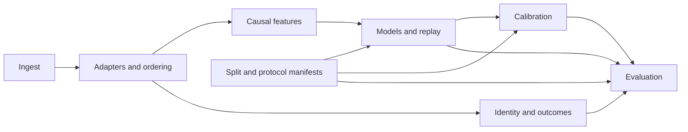

# Architecture: streaming ransomware evaluation

## Design paradigm

Pipes-and-filters inside a single Python package. Immutable versioned artifacts connect bounded stages; mutable state exists only within a trace, a model-training run, or a temporary artifact write. This is a research benchmark with a Kaggle GPU runner, not an endpoint protection service.

## Invariants and rules

### AD-1 - Immutable source and artifact identity

- **Binds:** all stages; R3, R4.
- **Prevents:** silent source changes, stale mixed outputs, two writers owning a run.
- **Rule:** ingest owns raw hashes; each stage owns its output type, writes a new version, validates before marking complete, and records input/config/code hashes. No consumer reads incomplete artifacts. Failures are recorded and quarantined, never silently dropped.

### AD-2 - Separate observations from outcomes

- **Binds:** adapters, features, identity, outcomes, models, evaluate; R1-R4.
- **Prevents:** future-state leakage and causal damage claims from names alone.
- **Rule:** CONTRACTS.md owns canonical schemas and semantics. Features/models cannot read outcome ledgers, finished-report signatures, labels at inference, or future metadata. Evaluate alone joins predictions and ledger. Unknown identity/status is explicit missingness, not zero.

### AD-3 - One observation and replay policy

- **Binds:** ordering, features, replay and every detector; R2, R4.
- **Prevents:** incompatible chronology, event counts, histories and alert boundaries.
- **Rule:** replay owns shared observation order, repeat-block handling, W/H, resets and k=1. Each primary observation contributes exactly one API token under CONTRACTS.md. Features and model state reset together before every block. Scores after an observation include its completed modifications in post-alert accounting. Partial chronology is gated or labeled; no fabricated intra-block timestamps. Primary models share API-only information and block-prefix histories.

### AD-4 - Disjoint statistical roles

- **Binds:** splits, training, tuning, calibration, test; R2, R4.
- **Prevents:** leakage, false family claims, nominal/test-FPR conflation.
- **Rule:** splits owns immutable grouped role membership before fitting. Train fits vocabulary/scalers/weights; tune selects configurations; independent benign calibration selects thresholds only; test estimates outcomes once. Group/family provenance outranks target counts. Report actual test FPR alongside nominal calibration budget.

### AD-5 - Metrics share cohorts and retain failures

- **Binds:** outcomes, evaluation, reporting; R1-R3.
- **Prevents:** low-damage misses looking successful, incomparable ranking cohorts, hidden censoring.
- **Rule:** use CONTRACTS.md equations, frozen target/cohort/grids and inclusive alert observation. Exact damage metrics require complete potentially qualifying-operation resolution; incomplete observations support only documented bounds/unknown outcomes. Misses fail success curves; terminal burden is observed only. Overall detection retains parseable inactive/truncated traces; missing damage remains missing. Seed variability and grouped paired uncertainty are separate.

### AD-6 - Resource and restart envelope

- **Binds:** CPU preparation, Kaggle runner, checkpoints; R4.
- **Prevents:** raw-data disk exhaustion, lost session progress and invalid resume.
- **Rule:** prepare bounded shards before GPU work; verify current resources/limits and pin tested versions per run. Record timing from setup start, reserve measured export time and save complete recovery state. Resume requires matching data/split/vocabulary/config hashes and a successful restart smoke test. Durable outputs must be accessible after session end.

### AD-7 - Gate-based scope and claims

- **Binds:** all delivery stages; R1-R6.
- **Prevents:** training on an invalid outcome or expanding claims to force success.
- **Rule:** EXECUTION-PLAN.md owns milestones and feasibility gates. No final model campaign precedes a validated measurement pipeline and frozen protocol. Transformer, multi-view features, explanations and robustness remain optional. Outcome/schema changes invalidate affected artifacts and experiments. Report agreement or inconclusive findings honestly.

### AD-8 - Docker enforces a bounded demonstration workload

- **Binds:** frozen-model export, API replay and demo runner; R6, R7.
- **Prevents:** conflating recorded Windows API scoring with Linux telemetry, and conflating the alarm with an intervention.
- **Rule:** the demo scores a paced recorded Windows API sequence with the exported checkpoint, vocabulary, block policy and threshold. The writer commits bounded marker operations to seeded dummy files in ephemeral container storage, then the scorer sees the corresponding observation. Monitor-only logs the alert. Enforcement logs the alert and closes the writer's gate before the next operation. Both modes share trace, seed, schedule and starting hashes. Verify CPU batched/streaming alert parity, log gate closure and compare final hashes. Use an unprivileged, networkless container with a read-only root filesystem and no writable host mounts.

## Consistency conventions

| Concern | Contract |
|---|---|
| Schemas and formulas | CONTRACTS.md is authoritative; version changes require compatibility/invalidation notes |
| Planning and gates | EXECUTION-PLAN.md is authoritative; remaining pilot settings explicitly conditional |
| Files | UTF-8 JSON manifests; partitioned Parquet tables; schema IDs and hashes required |
| Nulls | Unknown is not zero, false, empty history or a successful operation |
| Errors | Fail incompatible manifests; quarantine source parse failures; retain denominator accounting |
| Deployment | Local CPU preparation, private Kaggle GPU training and a Docker response demo driven by recorded Windows API input |
| Team | User plus Codex; user controls account/permissions, Codex implements and verifies |

## Structural seed and capability map

One `raneval` package, thin CLI, thin Kaggle notebook, fixture tests and artifact directories as specified in CONTRACTS.md. No existing implementation is implied.

| Requirement | Owner | Rules |
|---|---|---|
| R1 revised architecture | package and protocol | AD-1 through AD-7 |
| R2 controlled comparison | replay/calibrate/evaluate | AD-3, AD-4, AD-5 |
| R3 validated measurement | adapters/identity/outcomes | AD-1, AD-2, AD-7 |
| R4 delivery and reproducibility | all modules and runner | AD-1, AD-6, AD-7 |
| R5 XRan provenance | model configs/report | AD-3, AD-7 |
| R6 train and export on Kaggle | GPU runner and frozen bundle | AD-4, AD-6, AD-7 |
| R7 live response demonstration | recorded trace, model scorer, fixture writer | AD-3, AD-8 |

## Deferred with revisit conditions

- Exact package/CUDA lock: choose from measured Kaggle environment in M1, before fitting; documentation versions are references only.
- Raw-field adapter mappings, repeat interpretation and global-order availability: resolve in M1; block canonical primary data until resolved.
- Final W/H, modification target rule, quality thresholds and supported budget grid: freeze after detector-blind pilot and before model comparisons.
- Family assignment: use verified provenance in M1 or explicitly adopt group-held-out scope.
- Concrete deadline and available weekly compute: user has not specified; schedule remains an effort estimate.
- Optional Transformer, multi-view features and explanation designs: after core acceptance, with their own protocol changes and matched baselines.
- Native Windows telemetry and deployment effectiveness require a collector, input-parity validation and a separate evaluation protocol. The Docker milestone demonstrates the response gate on a controlled fixture workload.
