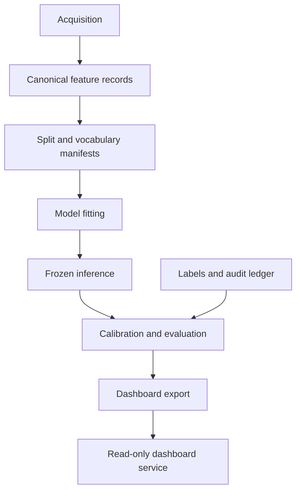

# Architecture: XRan original dataset

## Design paradigm

An offline, reproducible classification pipeline produces one verified model bundle and report. A lightweight Linux container serves that bundle and its dashboard. The observations describe Windows programs; the container's operating system does not change the data's meaning.

The authoritative source is the paper-associated [XRan release](https://github.com/sibelgulmez/XRan/tree/2cfebbfe45d3ed47b0204096186877e5991d6324). Its four downloaded CSV archives contain 520 named feature positions: `ApiCall_0..499`, `Dll_0..9`, and `Mutex_0..9`. The [content audit](../../../output/research/xran-original-data-audit.md) controls the actual usable cohort. This plan replaces the Linux multi-dataset direction; earlier implementations remain historical artifacts.

```mermaid
flowchart LR
  A[Four pinned XRan archives] --> B[Validate and audit every CSV row]
  B --> C[Duplicate groups and frozen splits]
  C --> D[Train-only feature encoding]
  D --> E[Count baseline / CNN / GRU]
  E --> F[Independent benign calibration]
  F --> G[Locked test and explanations]
  G --> H[Verified model bundle and metrics]
  H --> I[Lightweight Linux dashboard]
```

## Invariants and rules

### AD-1 — XRan-only lineage [ADOPTED]

- **Binds:** acquisition, preparation, training, export; X1–X3.
- **Prevents:** substituting provider collections or mixing old project models into the new claim.
- **Rule:** accept only the four pinned release archives or a separately audited original-author delivery explicitly incorporated into a new manifest. Save archive/member SHA-256, Git blob identity, source, revision, expected schema and every rejection. Existing EN2025, CRIBA, ebpfangel, generated benign data, model weights, vocabularies and thresholds are excluded. Old software may be reused after its contracts are adapted and tested. No binary execution is part of this pipeline.

### AD-2 — One endpoint sample and a fixed feature contract

- **Binds:** adapter, encoder, models, dashboard; X2–X4.
- **Prevents:** mistaking 520 serialized features for 520 timed calls or individual tasks.
- **Rule:** the prediction unit is one complete released CSV row. Preserve all 520 positions, token spelling, case and repetition. Namespace tokens by API/DLL/mutex view. Empty cells alone map to `PAD=0`; unseen nonempty tokens map to `UNK=1`. Keep `PRF` as a literal token until its meaning is verified. Do not infer a process, timestamp, syscall return, file outcome or executable identity from a row. Metadata, source name, row ID and labels cannot enter learned features. [CONTRACTS.md](CONTRACTS.md) owns interchange schemas.

### AD-3 — Frozen identity groups before learning

- **Binds:** preparation, split owner, every model; X2–X3.
- **Prevents:** exact feature duplicates leaking across roles or contradictory rows silently changing labels.
- **Rule:** canonicalize parsed cells without case folding or whitespace stripping, hash the complete vector, quarantine all full-vector groups containing both labels, and group remaining identical vectors before splitting. Retain one representative per nonconflicting feature group for the primary benchmark, recording multiplicity and original row membership. API-empty rows remain eligible for multiview classification when other views are populated. Entirely empty vectors are quarantined symmetrically. Split feature groups once into 60% train, 10% tune, 10% calibration and 20% test by deterministic source-stratified allocation; cross-source groups remain indivisible. Only benign calibration groups determine cutoffs; positive calibration groups remain reserved and unused. Fit vocabulary/scalers/weights exclusively on train. Feature grouping does not prove executable, family or temporal independence.

### AD-4 — Matched experiments and bounded claims

- **Binds:** trainers, evaluator, report; X3–X5.
- **Prevents:** feature-set or cohort changes masquerading as model improvements.
- **Rule:** primary count-logistic, two-layer CNN and GRU consume the same multiview rows, split and training-only vocabulary. Use fixed experiment seeds and tuning budgets recorded before fitting. CNN is a declared reconstruction because exact paper settings/splits are absent. API-only and missingness-only runs are labeled diagnostics on the same eligible multiview groups; API-empty cases stay in their denominators. Report API-identical overlap across roles and a group-by-nonempty-API sensitivity analysis before interpreting API-only performance. No fresh-family, real-time, damage or prevention claim follows from these CSVs. The missing MD cohort prevents the ransomware-versus-other-malware experiment.

### AD-5 — Operationally identical calibration and scoring

- **Binds:** calibration, export, service; X3–X4.
- **Prevents:** batch/runtime arithmetic differences moving decisions around the cutoff.
- **Rule:** calibrate a nominal 5% false-alarm budget per complete benign feature group on the exact deployment backend and preprocessing. Pick a threshold allowing at most `floor(0.05*n)` calibration alerts using `score >= threshold` with explicit tie handling. Freeze it before test. Export binds data/split/vocabulary/model/runtime hashes and the threshold. If backend, precision or preprocessing changes, repeat calibration on calibration data and validation before final test; any post-test change becomes a separately versioned development result, never a replacement of the locked result. Show actual test false alarms and uncertainty, not a guaranteed 5% deployment rate.

### AD-6 — One owner per artifact and clear environment boundaries

- **Binds:** local CPU pipeline, Kaggle training, deployment; X2–X6.
- **Prevents:** partial artifacts, lost recovery state or unsupported cloud-data handling.
- **Rule:** local preparation owns raw/audit/split artifacts; each training run owns a new output directory; evaluation alone joins labels with predictions; dashboard only reads completed validated exports. Raw archives are immutable. Do not upload the release or publish derivatives until applicable permission is established; public availability alone does not document redistribution terms. Kaggle is an execution option after that gate; local CPU remains available. Record actual GPU/VRAM, CPU/RAM, disk, packages, quota/session limits and internet setting before a run. Benchmark one GPU first; use the second for independent experiments unless measured DDP throughput justifies it. Save full recoverable state and verify restart plus durable export.

### AD-7 — Dashboard reports classification evidence

- **Binds:** API, UI, Docker image; X4–X5.
- **Prevents:** showing old Linux metrics as XRan results or presenting a confidence score as verified intent.
- **Rule:** serve dataset overview, source/quality counts, confusion matrix and class metrics, matched model comparison, and a selected-sample result with view-level evidence. Label data as Windows behavioral features and model as endpoint classification. Display source labels only for retrospective comparison, never feed them into inference. Reject unsupported row schemas, bundles and mismatched thresholds. Keep explanatory perturbation output distinct from causal evidence. The default UI contains no live protection, files-saved counter, Linux syscall monitor or interpolated detection time. Existing historical dashboard remains separate until the XRan service is verified.

### AD-8 — Raw-report extension requires new evidence

- **Binds:** future parser, streaming inference, response demo; X6.
- **Prevents:** recovering nonexistent timestamps or leaking full-report DLL/mutex data into prefixes.
- **Rule:** any user-supplied raw reports must be mapped to this dataset and audited for event order, repeats, task identity, returns, and first-observed DLL/mutex evidence. A genuine early detector requires prefix invariance when later events are removed. If chronology is absent, position truncation is only a sensitivity analysis. Real response or damage metrics require separately verified file outcomes. A harmless marker-write demo may illustrate a gate, but cannot establish ransomware prevention. These capabilities remain disabled for the downloaded CSV release.

## Dependency direction

Inference accepts only encoded views and its frozen bundle. It cannot query the label/audit ledger. Dashboard actions never mutate training, calibration or test artifacts.

## Structural seed and reuse

| Unit | Proposed location | Owner |
|---|---|---|
| Acquisition and audit | `scripts/inspect_xran_original.py` | Data agent; implemented during this analysis |
| Immutable release | `data/raw/xran-original/` | Acquisition |
| Canonical rows, groups, split, vocabulary | `src/raneval/xran_data.py`, `data/processed/xran-original/` | Data implementation |
| Endpoint models and training | `src/raneval/xran_models.py`, `src/raneval/train_xran.py` | Model implementation |
| Frozen inference and metrics | `src/raneval/xran_score.py`, `scripts/evaluate_xran.py` | Evaluation implementation |
| Kaggle packaging | `scripts/package_kaggle_xran.py` | Training operations |
| XRan dashboard and exports | `demo/xran_dashboard/`, `runs/xran-original/` | Dashboard implementation |

Except acquisition/audit, these locations are planned rather than implemented. Reuse tested hashing, checkpoint and threshold primitives where semantics match. The old API-stream `Trace` and per-task scorer are not the new data model; the existing Linux ONNX bundle cannot be loaded as an XRan model.

## Environment seed

Observed locally on 2026-11-17: Python 3.11.15, PyTorch 2.15.0+cpu, NumPy 2.4.6. Reuse the project's verified Debian slim/ONNX Runtime CPU deployment pattern when the new model exports successfully; actual XRan runtime versions are frozen after parity tests. Kaggle packages and limits are inspected at run time rather than inferred from the local CPU environment. This architecture does not bind an untested new framework or starter.

## Deferred and unresolved

- Exact XRan experiment reconstruction: resolve sample/split identities, model hyperparameters, original padding/truncation policy and `PRF` meaning before claiming reproduction.
- License/cloud-upload permission: the release requests citation but has no explicit license file. Record the permission basis before remote training or redistribution.
- Raw-report live detection: awaits auditable data from the same cohort; no substitute corpus is permitted.
- MD, family and temporal tests: await original MD and verified identity/family/date mappings.
- Larger models, live kernel collectors and automatic containment: outside this dataset-grounded classification phase.

Task sequence, verification and stop conditions are in [EXECUTION-PLAN.md](EXECUTION-PLAN.md).
