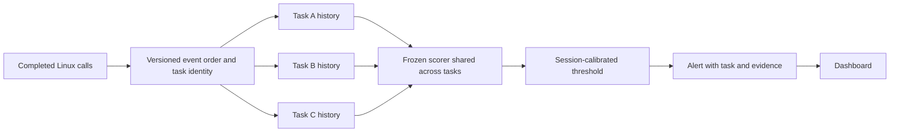

# Linux process detection implementation plan

The user authorized parallel implementation and verification of a design that distinguishes suspicious program behavior during normal concurrent activity. The BMad build, planning and debugging workflows guide this work. Task ownership and parallel execution follow the user's explicit request.

<frozen-after-approval>

## Intent

Separate each observed Linux task's causal model history so unrelated programs cannot corrupt its sequence. Evaluate the resulting alerts on mixed recorded operations with a common session-level false-alarm budget. Surface actual results and limitations in the dashboard.

## Constraints and edge cases

The inference key is the observed opaque task identity. The scorer has no access to dataset labels, source namespaces, family or operation outcomes beyond the defined input fields. Model weights remain frozen for the experiment. Calibration and test captures must be disjoint. Every candidate calibrates its session maximum from the same benign sessions at a nominal 5% target. Known positive captures are explicitly regression data.

| Input | Expected behavior |
|---|---|
| Two interleaved task identities | Independent recurrent and file-context states |
| More than 2,048 observations | Continue scoring with existing 256-event state resets |
| Missing identity or full state capacity | Explicit error before corrupting scorer state |
| Task exit and later reuse | Caller retires old state and supplies a new task incarnation |
| Overlapping completed calls | Explicit observed-order contract shared by offline and live projection |
| Benign processes inside positive session | Track false alerts separately from positive-actor detections |

</frozen-after-approval>

## Code map and parallel tasks

- [x] Agent process_state owns `src/raneval/process_score.py` and `tests/test_process_score.py`. Reuse existing token and context scorers, expose actor/global indices and explicit lifecycle APIs, and prove interleaving invariance.
- [x] Agent process_eval owns `scripts/evaluate_linux_process.py` and `runs/linux-process-benchmark`. Capture separate benign cohorts, freeze the protocol before scoring, compare shared and per-task inference, and export actual session thresholds and attributed outcomes.
- [x] Agent collector_fix owns `scripts/capture_linux_benign.py` and collector regression tests. Reproduce ordering differences, introduce an explicit observed-order contract, and remove the live demonstration's silent event cap.
- [x] Root integrates a continuous observer, publishes the process benchmark in the existing comparison view, documents architecture and evidence, and verifies the deployed Docker dashboard.

## Acceptance criteria

- Given two tasks, when their events interleave, then each task receives the same per-event scores as its isolated history.
- Given a long observation stream, when it passes the historical benchmark horizon, then the observer scores every delivered event.
- Given archived positives embedded in benign backgrounds, when each architecture scores them at its frozen common-budget threshold, then the report identifies both correct-task detections and benign-task false alarms.
- Given the deployed dashboard, when comparison opens, then the latest measured shared-versus-task results and the known-positive limitation appear.
- Given an overlapping-call fixture, when offline and live observed-order projections process it, then they agree on events and identities while preserving raw completion timing.

## Design notes

The decision describes a suspicious task history. A single read or write cannot establish malicious intent. An event recorder must eventually provide host/session/process-start identity and task lifecycle. The current source supplies a capture-local task identity, so host deployment remains a separate validation question. Model block resets and session-level calibration define the measured operating point.

## Verification

Run project and demo unittest discovery, new task-invariance and collector fixtures, the completed experiment's independent receipts, a real harmless Docker syscall stream through the integrated observer, JavaScript syntax checks, desktop/mobile dashboard checks, and the existing generated-file replay.

## Implementation notes

Independent agents own disjoint source files. Shared scorer and experiment interfaces are exchanged before integration. Architecture acceptance is based on the recorded results, including negative outcomes.

### Evidence-driven extension

The v6 diagnostic found that the frozen GRU did not transfer to per-task histories at the common alarm budget. Add a readout adaptation trained on TID-scoped original training positives and older benign training captures. Select with development data, excluding DarkSide and Erebus from adaptation selection. Freeze the adapter before evaluating a separate v7 benign cohort. Preserve v6 as the initial diagnostic, and show both baseline and adapted outcomes.

The source audit also found that DIO pid denotes process group while strace identifies tasks. Prepare a new positive artifact using DIO tid, retain the old artifact for reproducibility, and require equal operation/time projections and explicit actor provenance.

## Review disposition and delivery

Implemented and tested the defined architecture and reporting slice. The broad goal of reliable ransomware detection remains open.

- Corrected the DIO process-group/task mismatch. Both preparation and training/evaluation entry points now declare or require TID provenance.
- Corrected batch/live threshold drift by rerunning calibration and evaluation with the deployment scorer; the observer rejects a batch-derived point. Exact executed source snapshots retain experiment provenance.
- Independent reviewer identified missing TID guards; both fixed before delivery. Archived explicit-TID runs were unaffected.
- Final v7 streamed evaluation: adapted task GRU TP 10, FN 15, TN 49, FP 1, with the same outcome under increased background load. Known Erebus is detected early; known DarkSide is missed.
- 21 project and four demo tests passed. Independent replay matched 31/31 checked sessions, all calibration receipts, and all ten confusion matrices. A genuine benign Docker observation scored all 2,730 calls with zero alarms. Dashboard API equals the staged report; existing replay retained alert 26 and 358 hash-preserved files.
- Full method, scope and artifacts: [task-history evidence](../../output/research/linux-process-architecture.md). Dashboard browser receipt lives with final runtime results.
