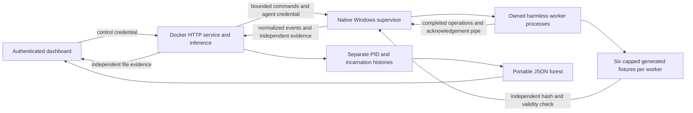
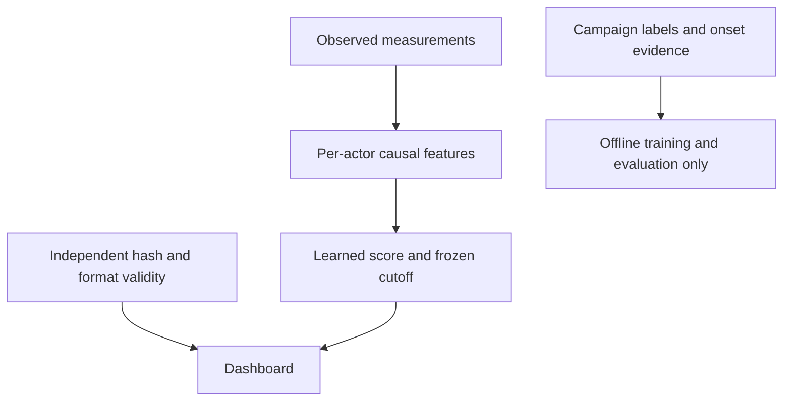

# Architecture

## Current native path

Actual I/O happens on Windows. The Linux container hosts inference/UI without a writable host mount or Docker socket. Cooperating workers record completed operations, offsets, before/after sizes, byte completion, entropy changes and changed-byte fractions. The supervisor validates only its fixed owned inventory after acknowledged operations. Independent checks are display evidence, not model labels supplied at inference.

[windows_native.py](../src/raneval/windows_native.py) builds 26 causal summaries over the last 128 actor events: target equality, size and coverage changes, ordered transitions and content-change measurements. It excludes scenario, worker kind, profile/seed, filenames, literal target hashes and fixture validity. A 32-tree JSON forest selected at depth 7/minimum leaf 4 produces scores at frozen threshold `0.742904033012732`.

State remains separate per PID/incarnation. Saved experiments compare interleaved versus isolated scoring. Missing required native measurements yield unavailable scores; historical events are not filled with measured zeros. [Event contract](../demo/windows_streaming/EVENTS.md).

## Models and tracks

| Track | Representation/model | Availability |
|---|---|---|
| Current native Windows | Enriched file operations; forest v2 | [Default bundle](../demo/windows_streaming/native-model.json) |
| Native experiment v1 | Earlier native features | [Compatibility runtime](../src/raneval/windows_native_v1.py), [archived bundle](../demo/windows_streaming/native-model-v1.json) |
| EN2025 streaming baseline | Projected CAPE events; linear classifier | [Frozen model](../demo/windows_streaming/model.json), [evaluation](../demo/windows_streaming/evaluation.json), [split](../demo/windows_streaming/split.json) |
| Original XRan project | Processed Windows API/DLL/mutex rows | [Selected project-trained bundles](../models/README.md), [training](../src/raneval/train_xran.py); no claim of original authors' weights |
| Earlier EN2025/Linux | Recorded API/syscall sequences; CNN/GRU and context/task models | [Research map](RESEARCH.md); inputs/checkpoints separate from the demo |

An alert associates suspicion with an actor's fixtures; it does not prove each is corrupted. Benign save/rotation can temporarily invalidate a fixture. Workers continue after detection. There is no containment engine, arbitrary process monitor or durable incident store.

The runtime caps histories at 512 actors and 128 events per actor, jobs at 128, alerts/errors at 100, active workers at four, commands at 32, and the supervisor queue at 1,024. Fixtures are capped at 16 KiB and workers at 30 seconds. Limits surface unavailable/overflow/error evidence. See the [technical runbook](../demo/windows_streaming/README.md) for cleanup checks and transport behavior.
