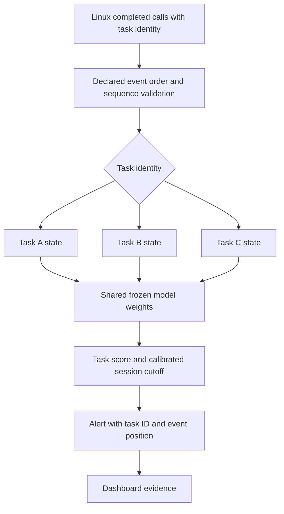

# Separate task history for Linux detection

Normal software and ransomware both issue real Linux system calls. The detector evaluates behavior over time. The experiment changes the ownership of that history so each observed task has independent model state. The router supports both token-only and file-context models; the final adapted GRU uses task-scoped operation tokens, not the earlier context correction.

## Implementation

The state router uses the event's opaque actor ID. It preserves the model's 256-event reset interval independently for each actor. Frozen model weights are shared. The router returns the actor ID, actor event position, whole-stream position, and score. It supports explicit task retirement and raises an error when identity is missing or state capacity is exhausted. It continues after the old 2,048-observation benchmark cap. [Task scorer](../../src/raneval/process_score.py)

The implementation review corrected an identity mismatch. DIO stores the process group as `pid` and individual task as `tid`. The new positive artifact explicitly selects `tid` to match the task identity captured by strace. It retains all original calls, times, paths and successful write sizes. The three DarkSide captures each contain six tasks, and the two Erebus captures each contain eleven. The raw trace labels describe a capture, so per-task attribution still relies on source provenance. [DIO parser](https://github.com/dsrhaslab/dio/blob/v1.1.0/dio-tracer/pkg/tracer/parser.go) · [Positive preparation](../../scripts/prepare_context_criba.py)

The input recorder now provides an explicit observed-order stream with contiguous sequence numbers and exact completion timestamps. Its offline observed-order option uses the same projection. Timestamps can arrive out of order, and the raw completion value is preserved alongside monotonic display time. Historical completion-sorted datasets retain their original ordering. The model comparison uses that historical ordering, so this run does not validate transfer between the two ordering contracts. [Collector](../../scripts/capture_linux_benign.py)

The continuous observer checks this schema and sequence before scoring. Its operating-point file identifies the frozen model hash, reset interval, per-task scope and session cutoff. After the calibration horizon, emitted rows explicitly identify the additional observations. The 5% target applies to the measured finite sessions, and indefinite monitoring needs its own alarm-rate evaluation. [Observer](../../src/raneval/observe_process.py)

Runtime calibration is required. Verification found that a batch-derived cutoff changed 19 of 50 calibration decisions when the same frozen head was scored one event at a time. Small floating-point differences crossed the one-representable-value boundary used for ties. The final experiment calibrates and evaluates using the deployed streaming scorer, and the continuous observer rejects operating points that lack this declaration. The initial batch output remains a diagnostic.

## Evaluation design

The initial v6 diagnostic compared event count, CNN, GRU refit and bounded context GRU. The final v7 comparison uses another 100 benign sources for calibration and 100 for testing, with no exact overlap against seven previous datasets. Sources are paired to form 50 calibration sessions and 50 test sessions. Each model and state-routing option receives a threshold from the maximum score across all actors in each calibration session, allowing at most two alarms under the nominal 5% target. The task-adapted model was frozen before v7 evaluation.

The final primary schedule begins with 128 benign operations and then alternates injected and background operations up to a 2,048-operation cap. A secondary schedule uses three background operations per injected operation with the same frozen cutoffs. Five known CRIBA ransomware recordings are each replayed against five test backgrounds, producing 25 positive sessions per schedule. These reuse five recordings and cannot be counted as 25 independent infections. The final five variants focus on count and GRU shared/task histories plus the adapted task GRU; CNN and bounded context were only included in the earlier diagnostic.

Per-task detection requires a threshold crossing on a task belonging to the positive source. Benign-source task alerts are counted separately. The archived capture label supplies provenance for this evaluation, and individual calls remain ordinary Linux operations whose harmfulness is inferred from the sequence.

## Scope

Production identity requires host, session and task incarnation so PID reuse cannot join unrelated programs. The present recorder supplies IDs valid within one capture and has limited lifecycle information. Parent-child grouping, multi-task attacks, unknown families and host changes need independent evaluation. Path identity and successful write size are behavioral inputs and do not establish encryption or quantify damage.

The first v6 comparison showed that the frozen GRU had learned a different sequence distribution from the new task streams. The next candidate adapts its readout from task-scoped training data. A separate v7 benign calibration and test cohort measures that adaptation after the candidate is frozen.

The task adaptation changes only the final readout using nine original training ransomware captures, 64 older benign training captures and 40 benign tuning captures. A positive capture contributes a bag loss over its task prefixes, which allows helpful or initialization tasks to remain unlabeled individually. DarkSide, Erebus and v7 captures are excluded from this adaptation's selection. The frozen backbone still inherits earlier development provenance.

[Implementation plan](../../_bmad-output/initiative-streaming-ransomware/plan-process-detection.md) · [Experiment script](../../scripts/evaluate_linux_process.py)

## Verified final results

Authoritative artifacts are in [results-v7-stream](../../runs/linux-process-benchmark/results-v7-stream/benchmark.json). The older `results-v7` folder uses batch arithmetic and is diagnostic only.

| Model and state | Calibration alarms / 50 | Clean test alarms / 50 | Early detections / 25 | Any detection / 25 |
|---|---:|---:|---:|---:|
| Count, shared | 2 | 5 | 0 | 5 |
| Count, per task | 1 | 4 | 0 | 25 |
| GRU, shared | 1 | 1 | 7 | 7 |
| Original GRU, per task | 2 | 2 | 0 | 0 |
| Adapted GRU, per task | 1 | 1 | 10 | 10 |

Early means within 120 positive-source operations. The adapted GRU detected all ten Erebus combinations at positive-source operation 30 and missed all fifteen DarkSide combinations. It produced no alerts on clean-background tasks inside those positive sessions. This held under both tested background loads. With three background operations per injected operation, the shared GRU lost all detections and the per-task count model's clean alarms increased to 7/50. The count model detected all positives late, but exceeded the actual 5% test alarm target under both loads. Each model used the same calibration budget; this does not guarantee the held-out alarm rate stays below it.

The adapted GRU's descriptive confusion matrix is TP 10, FN 15, TN 49, FP 1. Recall is 40%, precision 90.9%, specificity 98%, F1 55.6%, accuracy 78.7%, and balanced accuracy 69%. These values describe this constructed 75-session mixture. The observed clean alarm rate is 2%; its exact binomial 95% interval is approximately 0.05–10.65%, with additional dependence possible from repeated local workloads. No independent positive-generalization estimate follows from five reused captures.

The exported [operating point](../../runs/linux-process-benchmark/results-v7-stream/observer.json) binds the task bundle SHA-256 `e66a44cedbb3dc1d8171699eb3596a7d78aa0ced0aa9d6fac52b6112bbabda32` to cutoff `0.7335257183583056` and the streaming scorer. This fit ran locally on CPU; no new Kaggle run is claimed.

Verification completed on 2026-11-17:

- 21 project tests and four demo tests passed, including interleaving invariance, continuous observation, invalid sequence handling, and collector/task-ID fixtures. JavaScript syntax passed.
- Independent replay reproduced all 25 primary positive cases and six clean cases, including the false alarm, with zero score difference. All five calibration receipts and all ten schedule confusion matrices were recomputed. [Receipt](../../runs/linux-process-benchmark/results-v7-stream/stream-audit.json)
- A real harmless Docker log rotation produced 2,730 observed and scored calls without an alarm. The last 682 exceeded the calibration horizon and were explicitly marked. This single clean check does not calibrate indefinite monitoring or resolve the archive/live ordering difference. [Output](../../runs/linux-process-benchmark/results-v7-stream/live-observation.jsonl)
- The dashboard serves the exact staged report and exposes both background loads. Its separate frozen CNN replay still alerts at event 26 and preserves all 358 blocked dummy files by SHA-256; the benign replay has no alarm. [Receipt](../../runs/linux-process-benchmark/results-v7-stream/dashboard-verification.json)
- Desktop (1,440 px) and mobile (390 px) checks confirmed both schedule selections, family results and live-call counts, with no page overflow. Browser error-log collection could not finish after the automation transport timed out; this check remains unverified. [UI receipt](../../runs/linux-process-benchmark/results-v7-stream/ui-verification.json)

The implementation fixes state mixing, identity consistency and continuous scoring. Reliable detection remains unresolved: the task-adapted model misses DarkSide, only the readout was adapted, collector and host remain associated with class, and the positives were previously exposed during development. The next architectural candidate should combine task histories with related-process and shared-file behavior, evaluated with independently collected positives and negatives under the same collection contract. This candidate is a research direction, not an implemented or validated detector.
